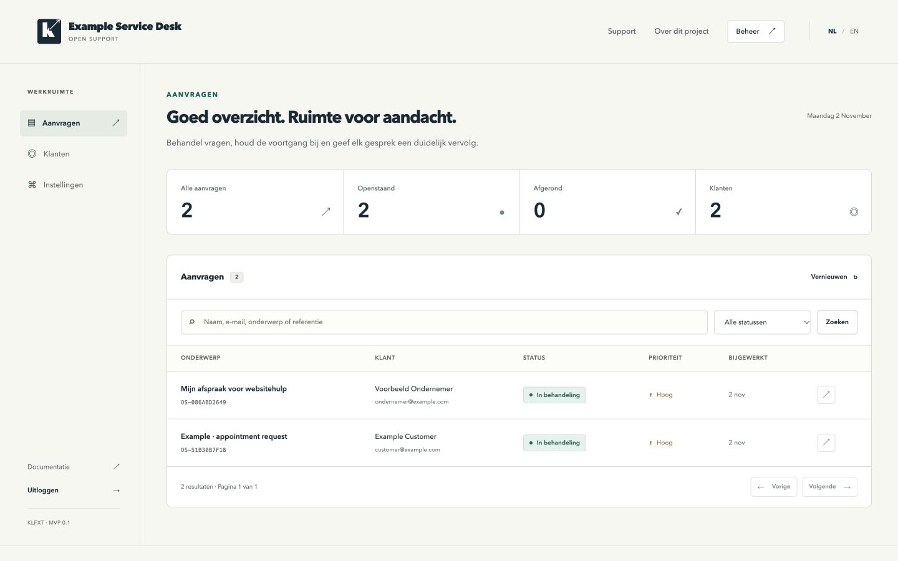

# KLFXT Open Support

A small, self-hosted support desk for a local service business: a clear request form for customers and one place for the owner to follow up.

**Pre-release alpha.** The owner approved the public source files and Apache-2.0 license on 2 November 2026. The [public repository](https://github.com/bradcroes/klfxt-open-support) contains the source; no production deployment has been created for this project. Local verification and release readiness are recorded in the [release checklist](docs/release-checklist.md); this README does not claim a completed deployment or production audit.

## v0.1 scope

- Dutch and English customer intake, a private tracking link, and a customer message history.
- One owner desk with status, priority, assignment labels, replies, internal notes, customer search, and queue totals.
- One business and one owner per deployment. The administrator uses a randomly generated 256-bit access key exchanged for an expiring HttpOnly session.
- A customer tracking link is a bearer capability: anyone who has it can read the customer-visible ticket and reply. It is shown after submission; no customer email is sent automatically.
- Optional owner notification email through a separately configured Resend outbox, disabled by default.
- Optional Calendly booking and Stripe hosted payment links. The application does not create payments, read payment status, or confirm bookings.
- Configurable retention from 30 to 730 days for resolved requests.

This MVP has no staff accounts, staff permissions, public registration, file attachments, inbound email processing, cross-business tenancy, or payment automation. An assignment is a queue label, not an access-control boundary. Future work is a proposal until implemented and verified; see [CHANGELOG.md](CHANGELOG.md).

## Try it locally

Use Node.js 24, npm, and Git:

```sh
git clone https://github.com/bradcroes/klfxt-open-support.git
cd klfxt-open-support
npm ci
npm run setup:local
npm run dev
```

Open [http://localhost:8787](http://localhost:8787). The public form is at `/`, customer tracking at `/track`, and the owner desk at `/admin`.

Local setup generates independent random secrets in the ignored `.dev.vars`, builds the UI, and applies migrations to local D1 storage. Read the local administrator key privately in your editor or password manager; never paste that file into an issue, screenshot, chat, or public repository. See [installation](docs/installation.md) for configuration and troubleshooting. Use synthetic requests when reviewing or taking screenshots. If reviewing a source ZIP, run `git init` in the extracted project first so the public-file check can enumerate its files.

## How it fits together

React and Vite provide the interface. A Hono TypeScript Worker serves the API and built assets; Cloudflare D1 stores requests, messages, sessions, and operational records. Customer capabilities are hashed at rest and carried in a URL fragment, then sent to the API in an Authorization header. Internal notes stay in the owner view. See the [API contract](docs/api-contract.md), [privacy guide](docs/privacy.md), and [security policy](SECURITY.md).

The supplied Worker configuration is local-first, with a placeholder D1 identifier. It is not a production deployment configuration. Hosting requires a separately approved Worker and database; follow [deployment](docs/deployment.md). Do not bind this project to existing KlikGefixt production resources.

## Work on the project

```sh
npm run check
npm test
npm run build
```

With the local server running, `npm run verify:local` checks the local application flow. Actual local results and remaining verification boundaries are recorded in [verification](docs/verification.md). Commands and development boundaries are documented in [development](docs/development.md). Read [CONTRIBUTING.md](CONTRIBUTING.md) and the [code of conduct](CODE_OF_CONDUCT.md) before contributing. Report vulnerabilities privately as described in [SECURITY.md](SECURITY.md).

## License

Licensed under **Apache-2.0**, approved by the owner on 2 November 2026. [LICENSE](LICENSE) contains the unmodified official license text; [NOTICE](NOTICE) contains project attribution. The rationale and MIT comparison are in [development](docs/development.md#license-choice). Third-party packages retain their own licenses, reproduced in [THIRD_PARTY_NOTICES.md](THIRD_PARTY_NOTICES.md). The software license does not grant rights to the KlikGefixt name or branding.

There is no announced support SLA or hosted service. This project has no claimed customers, contributors, certifications, or production adoption.

## Local demonstration

The screenshot below uses synthetic requests and example.com addresses. The counters are demonstration data, not customers or adoption claims.


